# DAVINCI CODE (다빈치 코드)

상대가 숨겨 둔 숫자 타일을 먼저 밝혀내는 **온라인 숫자 추리 대전 게임**이에요.
팀 stim(고제윤, 임재윤)의 네트워크프로그래밍 텀프로젝트 "다빈치 코드 온라인"의 완성판이에요.

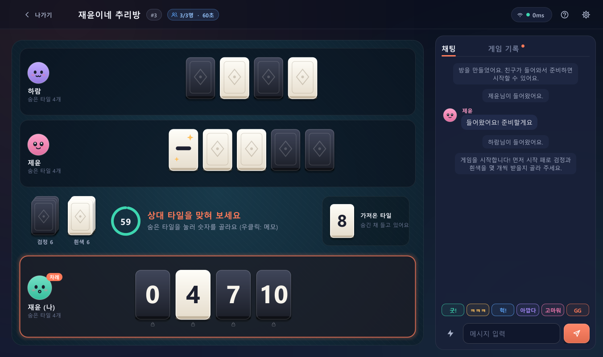

| 항목 | 내용 |
| --- | --- |
| 형태 | 2인 팀 프로젝트 (팀 stim: 고제윤, 임재윤) |
| 내 역할 | 서버와 클라이언트를 이용한 채팅 기능 구현 |
| 사용 기술 | Java 17 (소켓, 스레드, Swing), 직접 구현한 WebSocket, HTML · CSS · JavaScript |
| 규모 | Java 약 11,000줄과 테스트 약 1,900줄, 웹 화면 약 2,400줄. 외부 라이브러리는 쓰지 않았어요 |
| 특징 | PC 앱과 웹 브라우저가 같은 포트(30000)로 한 서버에 접속해 같은 방에서 대전해요 |

## 주요 기능

| 구분 | 내용 |
| --- | --- |
| 게임 | 2~4인 대전, 검정·흰색 0~11 타일, **시작 패 고르기**(처음 받을 검정·흰색 개수를 모두 동시에 선택), 정렬 규칙, 맞히면 계속/멈추기, 틀리면 가져온 타일 공개, 더미가 비면 내 타일 공개, 탈락·순위 |
| 새 요소 | **조커**(아무 자리에나 놓는 타일, 항상 사용), 이미 보이는 숫자는 숫자 고르기 창에서 자동으로 지워 줌, 타일 메모(우클릭) |
| 채팅 | 로비 채팅, 방 채팅(게임 중에도), 귓속말(`/w 닉네임 내용`), 빠른 채팅, 리액션 6종, 욕설 자동 가림, 도배 방지, 차단, 신고 |
| 방 | 방 목록, 빠른 시작, 비밀번호 방, 최대 인원·제한 시간·비밀번호 설정, 준비/시작, 방장 위임, 내보내기, 관전 |
| 접속 | 같은 Wi-Fi 서버 자동 검색(UDP), **내 PC에서 서버 열기**, 주소로 접속, 공식 서버 주소 내장, 끊기면 자동 재접속(게임 자리 60초 유지) |
| **웹 버전** | 서버 주소를 크롬·사파리 주소창에 넣으면 **설치 없이 브라우저로 바로 참가**. 휴대폰 화면 지원, PC 앱 사용자와 같은 방에서 함께 플레이 |
| 프로필 | 로비 오른쪽 위 내 프로필을 누르면 닉네임·캐릭터 바꾸기 (PC 앱·웹 모두) |
| 완성도 | 직접 그린 디자인·아이콘·캐릭터, 코드로 합성한 효과음, 애니메이션, 내 차례 작업 표시줄 알림, 설정 저장, 오류 로그, Windows 실행 패키지 |

## 바로 실행하기

실행 파일과 JAR은 저장소에 들어 있지 않아요. 아래 [빌드](#빌드)를 한 번 실행하면 `build\dist`에 생겨요.

### 1) 설치 프로그램 (Java 설치 필요 없음)
`build\dist\DAVINCI CODE-1.3.1.exe`를 실행해요. 관리자 권한 없이 내 계정에 설치되고(`%LOCALAPPDATA%\DAVINCI CODE`), 시작 메뉴의 *Team STIM* 폴더와 바탕화면에 바로가기가 생겨요. 지울 때는 Windows 설정 › 앱에서 *DAVINCI CODE*를 제거하면 돼요. 예전 이름(HiddenCode)으로 설치돼 있었다면 그 위에 덮어써서 바뀌고, 닉네임·캐릭터 같은 설정도 그대로 옮겨 와요.

### 2) 설치 없이 실행
`build\dist\DavinciCode-1.3.1-windows.zip` 압축을 풀고 `DAVINCI CODE\DAVINCI CODE.exe`를 실행해요.

### 3) JAR (Java 17 이상)
```bash
java -jar build/dist/DavinciCode.jar
```

한 PC에서 창을 여러 개 띄워 시연할 때는 프로필을 나누면 설정이 섞이지 않아요.
```bash
java -Ddc.profile=2 -jar build/dist/DavinciCode.jar
```

### 4) 전용 서버 (창 없이)
```bash
java -jar build/dist/DavinciCode-Server.jar --port 30000
```
옵션: `--data 폴더`(신고 기록·로그 저장 위치, 기본 `./data`), `--name 이름`, `--no-lan`(같은 Wi-Fi 검색 끄기), `--bind 주소`, `--verbose`(모든 메시지 로그).
실행 중 콘솔 명령: `status`, `users`, `rooms`, `notice 내용`, `kick 닉네임`, `stop`.

### 5) 웹 브라우저 (설치 필요 없음)
서버가 켜져 있으면 그 주소를 브라우저 주소창에 넣기만 하면 돼요. 예: `http://192.168.0.12:30000`
게임 서버가 같은 포트로 웹 게임 화면도 보내 주기 때문에, 따로 웹 서버를 띄울 필요가 없어요. 휴대폰 브라우저에서도 되고, PC 앱 사용자와 같은 방에서 함께 할 수 있어요.

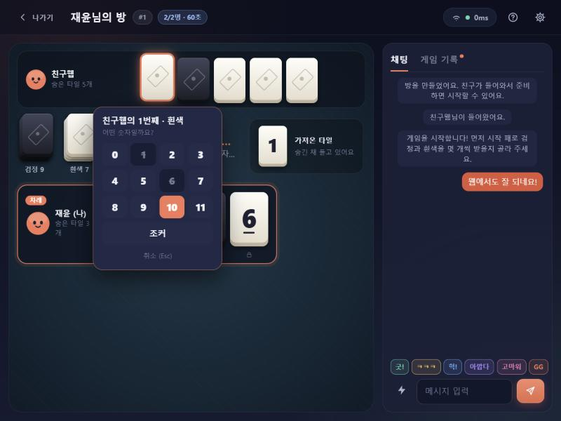

## 친구와 하는 방법

게임은 사람 2~4명이 함께 해요 (AI는 없어요). 혼자 시험해 보려면 앱 창을 두 개 띄우거나(`-Ddc.profile=2`), 앱으로 서버를 열고 브라우저로 한 번 더 들어오면 돼요.

1. **같은 Wi-Fi**: 한 명이 첫 화면의 *내 PC에서 서버 열기*를 누르면, 다른 사람 화면의 *같은 Wi-Fi에서 찾기*에 자동으로 나타나요. 처음 열 때 Windows 방화벽 창이 뜨면 "허용"을 눌러야 해요.
2. **초대 주소 보내기 (웹)**: 서버를 연 사람이 로비 위쪽 "내 서버" 표시를 누르면 `http://IP:30000` 주소가 복사돼요. 받은 친구는 앱 설치 없이 크롬·사파리 주소창에 붙여넣으면 바로 들어와요. PC 앱의 *주소로 접속*에 넣어도 돼요.
3. **공식 서버**: 클라우드 서버에 전용 서버를 띄우고, 프로젝트 폴더에 `official-server.txt`(내용 예: `play.example.com:30000`)를 만든 뒤 빌드하면 앱 접속 화면에 "공식 서버" 카드가 생겨요. 웹으로는 `http://play.example.com:30000`으로 들어와요. Docker 설정은 `packaging/Dockerfile`에 있어요.

> 같은 Wi-Fi가 아닌 친구(다른 집, 휴대폰 데이터)는 서버 PC가 인터넷에서 보여야 들어올 수 있어요. 공유기에서 30000번 포트를 서버 PC로 넘겨 주거나(포트 포워딩), 클라우드에 전용 서버를 띄워야 해요. HTTPS 주소로 서비스하려면 Caddy·nginx 같은 리버스 프록시를 앞에 두면 웹 화면이 자동으로 `wss://`로 연결해요.

## 빌드

JDK 17 이상(이 PC는 Temurin 25)만 있으면 돼요. 외부 라이브러리는 쓰지 않아요.

```powershell
.\build.ps1             # 컴파일 → 테스트 → JAR → 실행 파일 패키지(zip)
.\build.ps1 -SkipTests  # 테스트 생략
.\build.ps1 -JarOnly    # JAR만
```

결과물은 `build\dist`에 생겨요.

### 설치 프로그램 만들기

WiX Toolset 5가 있으면 `build.ps1`이 Windows 설치 프로그램(`DAVINCI CODE-1.3.1.exe`)도 같이 만들어요. 처음 한 번만 설치하면 돼요 (.NET SDK 필요).

```powershell
dotnet tool install --global wix --version 5.0.2
wix extension add -g WixToolset.Util.wixext/5.0.2
wix extension add -g WixToolset.UI.wixext/5.0.2
```

설치 프로그램 정보는 영문 코드페이지라서 패키지 설명(`--description`)에는 한글을 넣으면 안 돼요 (WiX 오류 311). 업그레이드 UUID는 `build.ps1`에 고정돼 있어서, 버전을 올려 다시 설치하면 이전 버전을 덮어써요.
macOS/Linux는 `./build.sh`를 써요.

Eclipse에서 열 때는 `src/main/java`와 `src/test/java`를 소스 폴더로 지정하고 인코딩을 UTF-8로 맞추면 돼요. 앱 시작점은 `stim.davincicode.client.ClientMain`, 서버 시작점은 `stim.davincicode.server.ServerMain`이에요.

## 테스트

| 테스트 | 내용 | 결과 |
| --- | --- | --- |
| `server.EngineTest` | 정렬·삽입, **시작 패 고르기**(범위·중복 막기, 개수 비밀 유지, 고른 대로 받기, 시간 초과, 고르는 중 기권, 극단 조합), 정보 은닉, 맞히기/틀리기, 빈 더미, 기권, 규칙 위반 차단, 필터, **자동 대전 3,000판**(타일 수·정렬 불변식, 숫자 고르기 창이 정답을 지우지 않는지 26만 회 검사) | 9,108개 통과 |
| `server.NetTest` | 실제 소켓으로 접속·닉네임 중복·로비/방 채팅·귓속말·욕설 가림·도배 방지·방/준비/시작·시작 패 고르기(개수 비밀, 고른 대로 받기)·관전·재접속·기권·고르는 중 나가기·신고·중복 접속·프로필(닉네임·캐릭터) 바꾸기 | 45개 통과 |
| `server.WebTest` | 웹 화면 파일 전송, 폴더 밖·목록 밖 접근 차단, 보안 헤더, WebSocket 연결 키·쪼개진 프레임·긴 프레임·ping/pong·닫기·마스크 없는 프레임 차단, 웹↔앱 채팅(한글·이모지), 웹과 앱이 한 방에서 시작 패를 고르고 끝까지 한 판 | 33개 통과 |
| `test/web/parity.mjs` | 웹(JavaScript) 상태 해석(시작 패 고르기 포함)·숫자 계산이 Java와 같은 답을 내는지 자동 대전 4,265개 장면에서 비교 (`DeductionDump`로 장면 생성, Node.js로 실행) | 20,216개 후보 모두 같음 |
| `client.FlowCheck` | 앱 창을 띄워 내 PC 서버 열기 → 친구와 방 → 게임판에서 시작 패 카드 클릭 → 끝까지 → 결과 → 같은 Wi-Fi 검색에 나타나는지 → 닫기 | 10개 통과 |
| `client.UiShots` | 앱을 자동 조작하며 모든 화면 스크린샷 저장 (`docs/screenshots`) | — |

```powershell
java -cp "build\classes;build\test-classes" stim.davincicode.client.FlowCheck
```

## 구조

```
src/main/java/stim/davincicode/
├─ common/   프로토콜(Proto, Msg), 화면용 게임 상태(GameView), 숫자 계산(Deduction: 숫자 고르기 창이 이미 보이는 숫자를 지울 때 씀), 채팅 필터, 닉네임 규칙
├─ server/   GameServer(접속), Gate(앱/웹 입구), Transport(TCP·WebSocket), Connection(읽기/쓰기 스레드), Hub(로비·방·채팅),
│            Room, Game(규칙 엔진), Reports(신고 기록), LanBeacon
└─ client/   App(창·화면 전환·연결), 화면(Title/Connect/Lobby/Room), BoardView(게임판), ChatPanel, Dialogs, NetClient, LanFinder, Sound, Prefs
   └─ ui/    디자인 시스템(색·글꼴·버튼·입력창·대화상자·알림·아이콘·캐릭터·타일 그림)
src/main/resources/stim/davincicode/web/
   index.html, style.css, app.js(웹 화면), proto.js(프로토콜·상태 해석·숫자 계산을 JS로 옮긴 것), 아이콘, manifest
```

같은 포트(30000)로 PC 앱과 브라우저가 모두 들어와요. 서버는 연결의 첫 바이트를 보고 가른다: PC 앱의 `writeUTF`는 길이(0x00…)로 시작하고, 브라우저는 `GET /`로 시작해요. 브라우저에는 웹 게임 화면 파일을 보내 주고, `/ws`로 WebSocket 연결이 오면 앱과 똑같은 메시지(탭으로 나눈 한 줄)를 WebSocket 텍스트 프레임에 담아 주고받아요. 그래서 서버 로직(Hub)은 상대가 앱인지 웹인지 구분하지 않아요.

### 수업 코드에서 달라진 점

| 수업 코드 (1주차) | 완성판 | 이유 |
| --- | --- | --- |
| `AcceptServer` 스레드 | `GameServer.AcceptServer` | 그대로 유지 |
| `UserService` 스레드 1개 (읽기+쓰기) | `Connection`의 읽기 스레드 + 쓰기 스레드(큐) | 느린 클라이언트 한 명이 서버 전체를 멈추지 않게 |
| `Vector UserVec` + `synchronized` | 게임 로직 스레드 1개(`Hub`)가 모든 상태를 순서대로 처리 | 동시에 온 요청이 섞이지 않고, 타이머도 같은 스레드에서 안전하게 |
| `/HAND` 손패만 전송 | 받는 사람마다 볼 수 있는 정보만 담은 `STATE` 전체 상태 | 정보 은닉을 한 곳(`Game.snapshot`)에서 보장, 재접속·관전이 쉬워짐 |
| `WriteAll` / `WriteOne` | 그대로 개념 유지 (`audience()`에 보내기 / `send`) | |
| `readUTF` / `writeUTF`만 | `Transport` 뒤로 숨김: 앱은 `readUTF`/`writeUTF`, 웹은 WebSocket 프레임 (직접 구현) | 같은 서버에 브라우저도 접속 |

파일마다 하는 일은 [docs/FILES.md](docs/FILES.md), 자세한 메시지 형식은 [docs/PROTOCOL.md](docs/PROTOCOL.md), 저장하는 정보는 [docs/PRIVACY.md](docs/PRIVACY.md)에 있어요.

## 규칙과 디자인에 대해

보드게임 "다빈치 코드"의 숫자 타일 추리 규칙을 바탕으로 직접 구현했고, 화면·아이콘·캐릭터·효과음은 모두 코드로 직접 만들었어요. 네트워크프로그래밍 수업 프로젝트 제출용이고, 앱 스토어 출시나 판매를 위한 프로그램이 아니에요.

## 스크린샷

| 타이틀 | 로비 |
| --- | --- |
| 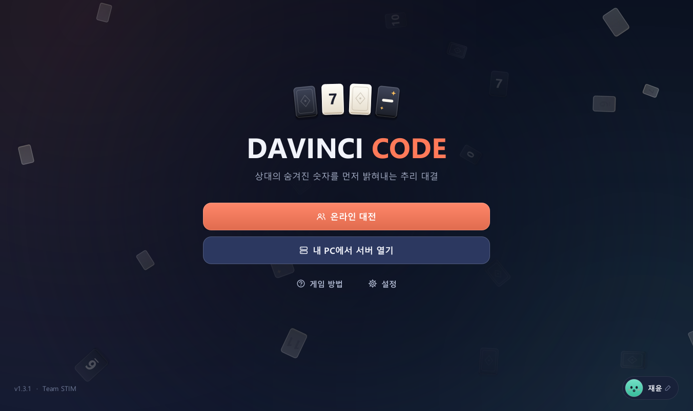 | 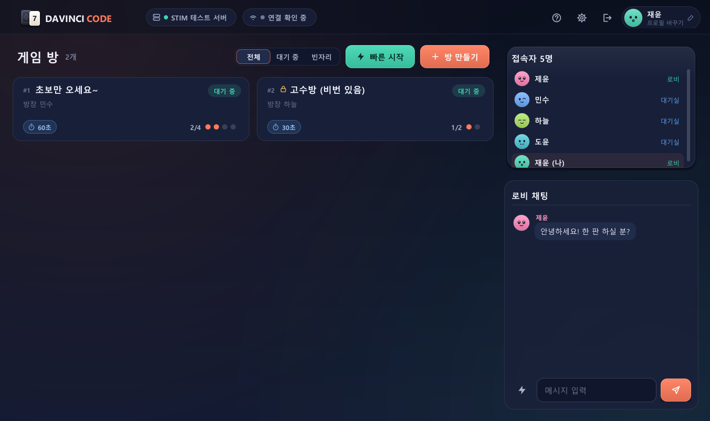 |
| 프로필 바꾸기 | 대기실 |
| 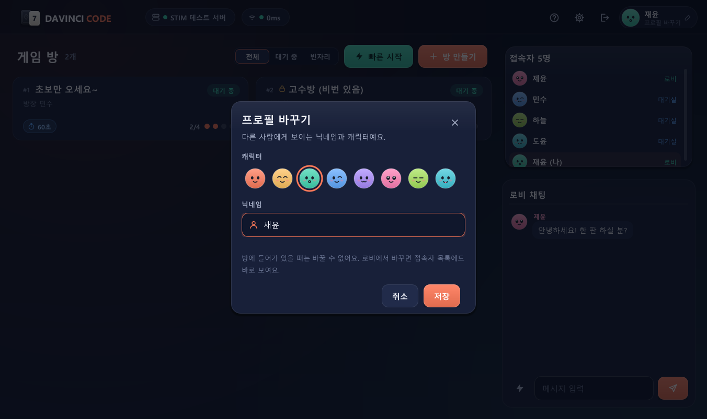 | 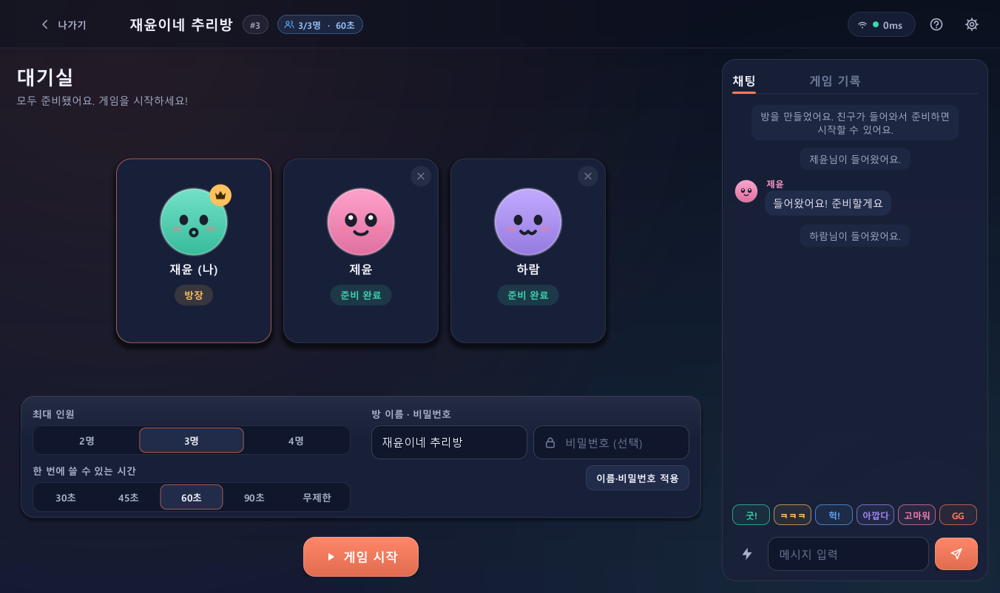 |
| 시작 패 고르기 | 게임 |
| 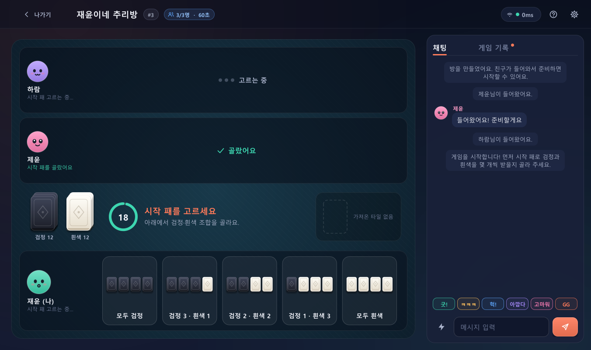 |  |
| 숫자 고르기 | 결과 |
| 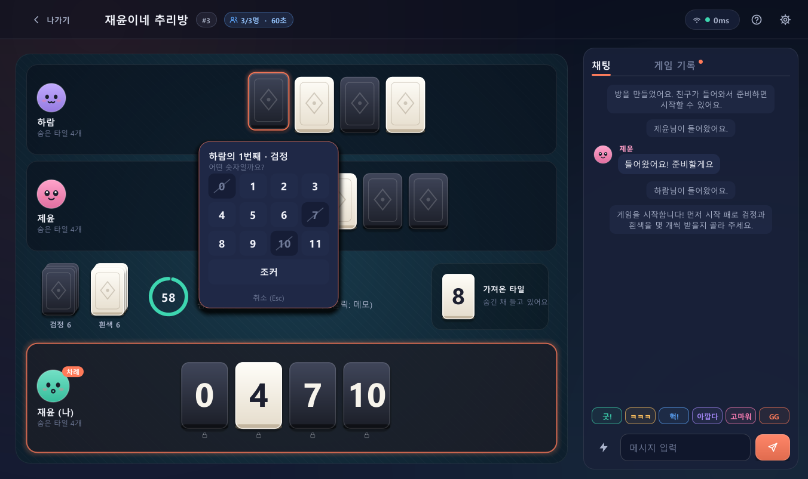 | 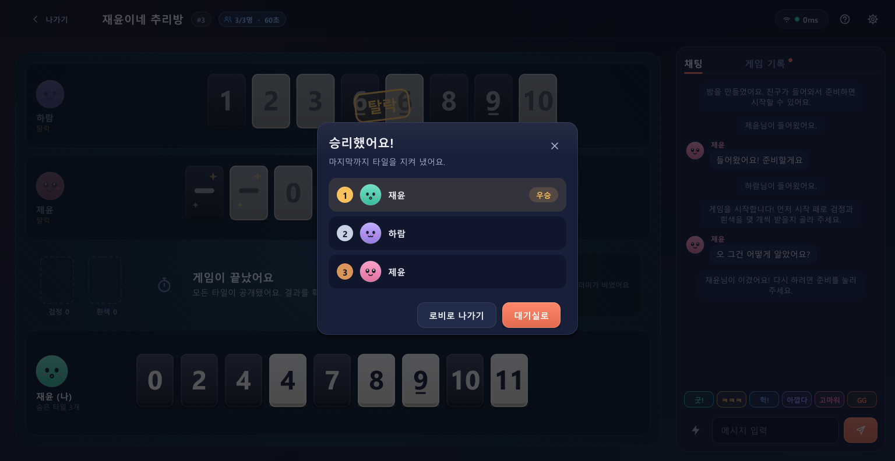 |
| 관전 (4인) | 웹 (휴대폰) |
| 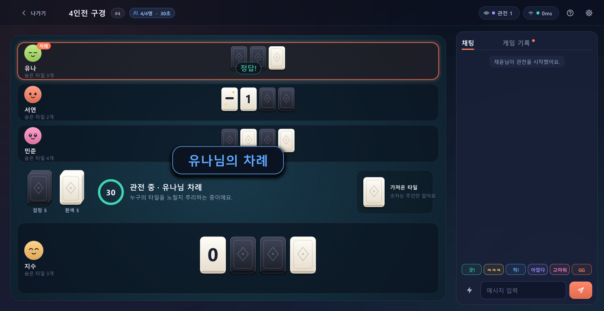 | 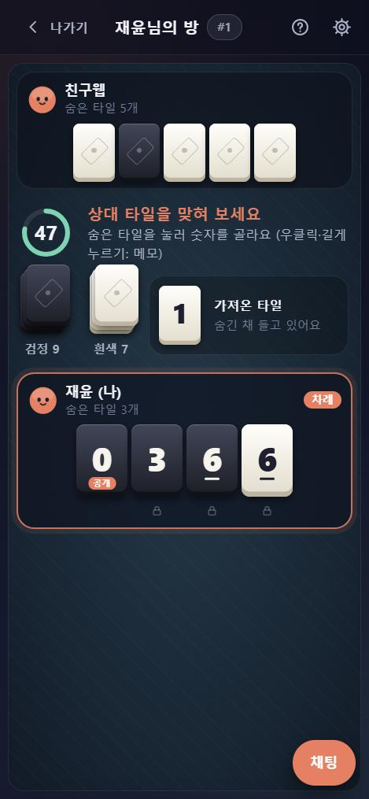 |
